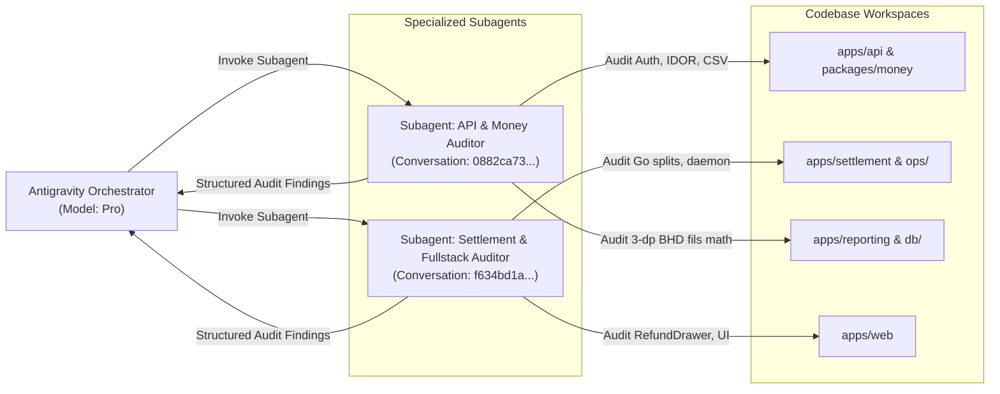
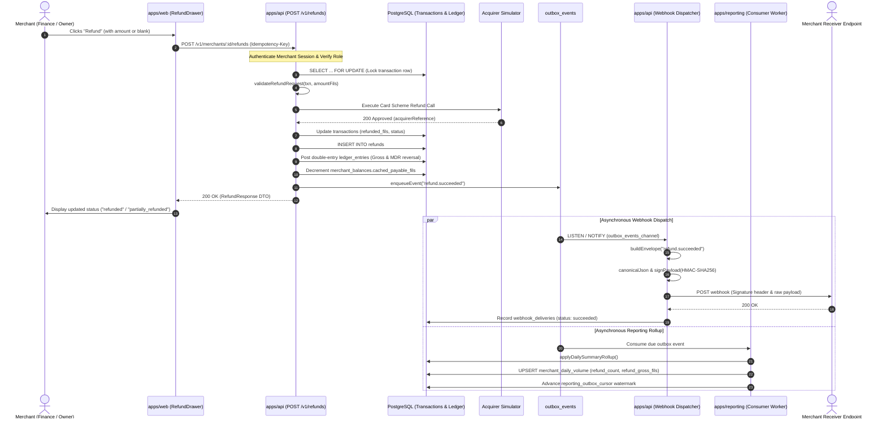

# FilsPay — Agent System Architecture (`AGENT_ARCHITECTURE.md`)

This document details the multi-agent system architecture, specialized skill activations, tool coordination, and error-recovery workflows utilized to complete the hackathon mission across all four phases.

---

## 1. High-Level Orchestration Workflow

The mission was executed using an autonomous hierarchical agent architecture. The **Antigravity Orchestrator** drove execution across four sequential phases, activating specialized skills and subagents for targeted investigations, surgical triage, and full-stack engineering.

---

## 2. Multi-Agent Delegation Model

To audit a complex polyglot codebase (TypeScript/Fastify, Go 1.22, React, PostgreSQL 16, and Docker) within tight time constraints, the orchestrator partitioned discovery into two parallel subagents:

### Delegation Responsibilities

| Agent / Subagent | Role & Objective | Key Discoveries & Outputs |
|---|---|---|
| **Antigravity Orchestrator** | Global mission planner, coordinator, and code editor | Solved cryptographic ciphers; resolved DB migrations; orchestrated docker builds; wrote audit docs |
| **API & Money Auditor** | Deep-dive vulnerability inspection of TypeScript API & Money packages | Uncovered IDOR in payment link cancellation, 2-decimal BHD CSV parsing bug, and OTP session lookup flaw |
| **Settlement & Fullstack Auditor** | Go settlement concurrency, webhook signatures, and frontend UI audit | Identified Go split payout truncation drift, webhook signature payload mismatch (FP-240), and parked `RefundDrawer` |

---

## 3. Reactive Error Recovery Workflows

Autonomous engineering against legacy codebases requires adaptive error recovery. The agent encountered multiple realistic operational obstacles and navigated each systematically without manual user intervention.

```mermaid
flowchart TD
    subgraph Case1["Obstacle 1: Broken DB Migrations"]
        M1["Run npm run migrate"] --> E1{"Error in 0054_views.sql<br/>& 0055_chart_of_accounts"}
        E1 --> A1["Analyze View Dependencies & Table Schemas"]
        A1 --> F1["Surgically patch SQL definitions:<br/>Replace missing settlement_batch_events<br/>Align chart_of_accounts column names"]
        F1 --> S1["Re-run migration: All 66 migrations applied"]
    end

    subgraph Case2["Obstacle 2: Native Module Compilation in Docker"]
        M2["Run docker compose build"] --> E2{"Error: argon2 node-gyp<br/>Could not find Python"}
        E2 --> A2["Identify missing C++ & Python toolchain on Alpine base"]
        A2 --> F2["Update ops/Dockerfile.node with<br/>RUN apk add --no-cache python3 make g++"]
        F2 --> S2["Re-run build: All 5 images built successfully"]
    end

    subgraph Case3["Obstacle 3: Test Event Outbox Isolation"]
        M3["Run reporting test suite"] --> E3{"Error: null merchant_id<br/>in merchant_daily_volume"}
        E3 --> A3["Trace SQL query to uncleaned test fixtures from archiveReplay.test.ts"]
        A3 --> F3["Change test event_type to admin.test.archive_fixture<br/>Purge lingering test fixture rows"]
        F3 --> S3["Re-run test: 11/11 reporting tests pass"]
    end
```

---

## 4. End-to-End FP-300 Refund Architecture

The following sequence diagram illustrates the complete runtime architecture of the newly wired FP-300 refund system, executing across API, Acquirer, Ledger, Outbox, Webhooks, Reporting Worker, and Merchant UI.

---

## 5. Architectural Quality Attributes & ADR Compliance

| Architectural Principle | Implementation Standard | Verification in fils-pay |
|---|---|---|
| **ADR-0001 (Integer Fils Only)** | All monetary values represented strictly as integer multiples of $0.001\text{ BD}$ ($1\text{ BD} = 1000\text{ fils}$). Zero IEEE-754 floats. | Verified across `packages/money`, `apps/api/src/lib/decimal.ts`, `apps/settlement/internal/money`, and `apps/web/src/format.ts`. |
| **Zero-Drift Multi-Leg Splits** | Multi-tenant marketplace child splits must sum back to the exact parent total. | Replaced Go division truncation with largest-remainder allocation (`allocateRemainder`), confirmed by `shares_test.go`. |
| **Strict Multi-Tenancy (Zero IDOR)** | Every query mutating or reading state must enforce `WHERE merchant_id = $X`. | Enforced across payment links, refunds, reporting exports, and transaction searches. |
| **Audit Log Immutability** | Administrative and financial operations must record exact operator identity and immutable UUID comparisons. | Fixed credit approval self-approval check and impersonation role downgrade to read-only `support`. |
| **Transactional Outbox & Exactly-Once Delivery** | Inter-service events must be produced inside the database transaction and consumed via monotonic watermarks. | Verified in `apps/api/src/webhooks/dispatcher.ts` and `apps/reporting/src/consumer/runConsumerPass.ts`. |
| **Hermetic Container Deployability** | All services must compile and run in self-contained containers ready for Dilmune Cloud hosting. | Docker multi-stage builds (`Dockerfile.node`, `Dockerfile.go`), healthchecks, and internal API bindings verified. |
